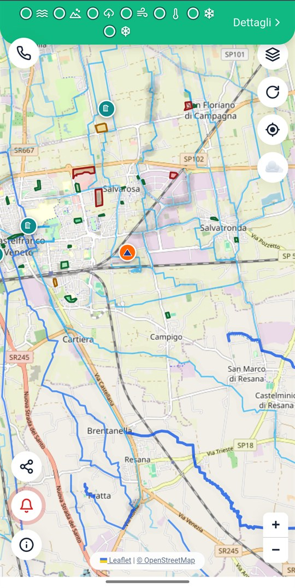
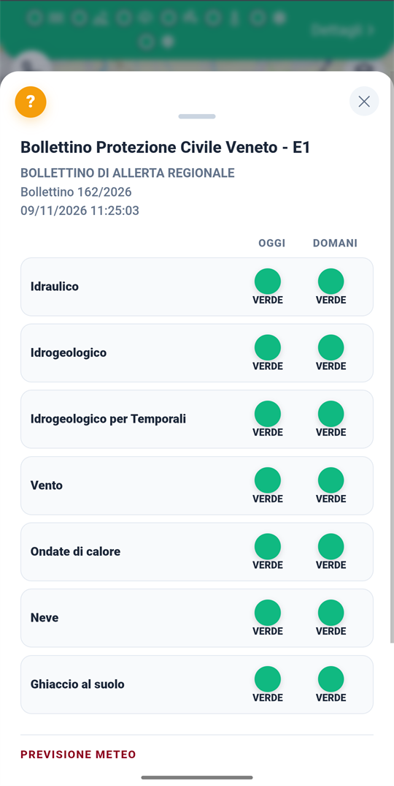
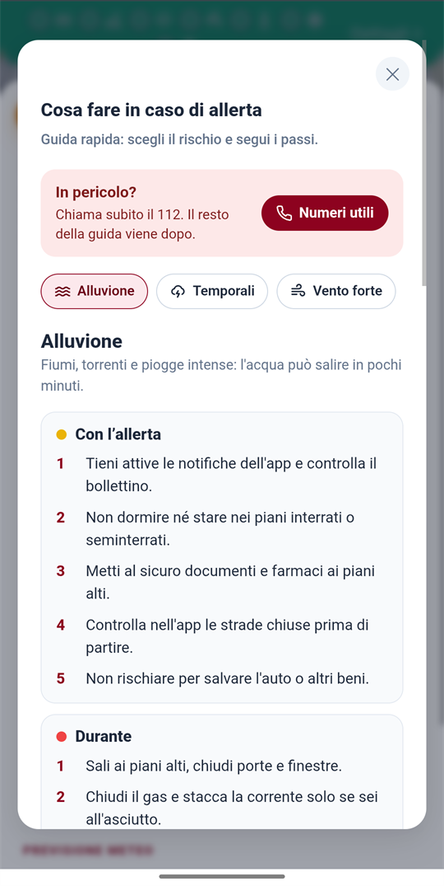

<div align="center">


# CastelSafe

**Allerte meteo, sensori dei fiumi e chiusure stradali di Castelfranco Veneto, in tempo reale.**

[](https://newscastelfrancoveneto-lab.github.io/CastelSafe/)
[](https://github.com/newscastelfrancoveneto-lab/CastelSafe-APK/releases/latest)


</div>

---

CastelSafe è un progetto civico per i cittadini di Castelfranco Veneto. Riunisce in un'unica app le informazioni di protezione civile che altrimenti sono sparse tra più siti ufficiali: il bollettino di allerta regionale, i livelli dei corsi d'acqua, le piogge, il radar e le strade chiuse. Quando la situazione cambia, avvisa con una notifica.

<div align="center">

| Mappa e allerta | Bollettino regionale | Cosa fare in caso di allerta |
|:---:|:---:|:---:|
|  |  |  |

</div>

## Cosa fa

| | |
|---|---|
| **Allerta regionale** | Il bollettino della Protezione Civile del Veneto per la zona **E1**, per oggi e domani, su sette rischi: idraulico, idrogeologico, temporali, vento, ondate di calore, neve e ghiaccio al suolo. Ogni rischio ha il suo colore (verde, giallo, arancione, rosso). |
| **Sensori ARPAV** | Livelli idrometrici, portata, pioggia (istantanea e cumulata sulle 24 ore), vento, temperatura, umidità e radiazione solare dalle stazioni di Castelfranco e del Muson, con grafici interattivi e soglie di attenzione. |
| **Mappa** | Strade e aree chiuse, divieti e pericoli segnalati dal Comune, aree di protezione civile e corsi d'acqua su mappa OpenStreetMap, con navigazione verso la destinazione. |
| **Radar e previsioni** | Radar delle precipitazioni del Dipartimento della Protezione Civile e previsioni meteo ARPAV. |
| **Notifiche** | Avvisi push per nuovi bollettini, soglie dei sensori superate e nuove chiusure. |
| **Cosa fare** | Una guida pratica per ogni rischio (alluvione, temporali, vento forte, neve e ghiaccio, caldo, terremoto, rischio industriale) con le azioni da fare prima, durante e dopo, e i numeri utili a portata di tocco. |

## Provala

### Dal browser, senza installare nulla
Apri **<https://newscastelfrancoveneto-lab.github.io/CastelSafe/>**.

### Come app sul telefono (consigliato)
È una Progressive Web App: si installa dal browser e si comporta come un'app, con la sua icona, a schermo intero e con le notifiche.

- **Android (Chrome):** menu ⋮ → *Installa app* (oppure il banner che compare in pagina).
- **iPhone (Safari):** pulsante *Condividi* → *Aggiungi alla schermata Home*. Le notifiche funzionano dall'app aggiunta alla Home.

### App Android nativa
Per Android esiste anche un'app nativa, con widget e notifiche più affidabili: **[scarica l'ultima versione](https://github.com/newscastelfrancoveneto-lab/CastelSafe-APK/releases/latest)**. Il codice è nella repo [CastelSafe-APK](https://github.com/newscastelfrancoveneto-lab/CastelSafe-APK).

## Da dove arrivano i dati

CastelSafe non produce dati propri: li legge dalle fonti ufficiali e li presenta in modo leggibile.

| Dato | Fonte |
|---|---|
| Bollettino di allerta | Regione del Veneto, Protezione Civile |
| Livelli, portate, piogge, vento, temperatura | ARPAV, rete di monitoraggio (licenza [CC BY 4.0](https://creativecommons.org/licenses/by/4.0/deed.it)) |
| Previsioni meteo | ARPAV |
| Radar delle precipitazioni | Dipartimento della Protezione Civile |
| Cartografia | © contributori di [OpenStreetMap](https://www.openstreetmap.org/copyright) |
| Chiusure e avvisi | Segnalazioni inserite dagli amministratori |

> I dati ARPAV sono pubblicati senza validazione preventiva e possono essere corretti in un secondo momento.

## Come è fatto

- **Front end:** una singola pagina statica (HTML, CSS e JavaScript senza framework) pubblicata con GitHub Pages.
- **Offline e aggiornamenti:** un *service worker* tiene in cache la pagina per un avvio istantaneo e avvisa quando è disponibile una nuova versione.
- **Notifiche:** Web Push standard, con sottoscrizione volontaria.
- **Librerie:** [Leaflet](https://leafletjs.com/) per la mappa e [Chart.js](https://www.chartjs.org/) per i grafici.
- **Dati e avvisi:** un servizio dedicato raccoglie i dati ufficiali, li verifica e invia le notifiche. È tenuto fuori da questa repo.

```
.
├── index.html       l'app
├── sw.js            service worker: cache, aggiornamenti, notifiche
├── manifest.json    metadati per l'installazione come app
├── admin.html       area riservata agli amministratori (chiusure e avvisi)
└── icon-*.png       icone
```

L'area `admin.html` è accessibile solo a chi è autorizzato.

## Sviluppo

Non c'è nessuna fase di build: i file sono serviti così come sono.

```bash
git clone https://github.com/newscastelfrancoveneto-lab/CastelSafe.git
cd CastelSafe
python -m http.server 8080      # poi apri http://localhost:8080
```

Dalla copia locale l'app mostra l'interfaccia, ma i dati in tempo reale e le notifiche richiedono il servizio dedicato.

**Pubblicare una modifica.** GitHub Pages pubblica dal ramo `main`. Ad ogni modifica a `index.html` va cambiata la stringa `APP_VERSION` in `sw.js`: è ciò che permette al browser di accorgersi della nuova versione e mostrare agli utenti il pulsante *Aggiorna*.

## Avvertenza

CastelSafe è uno strumento informativo e **non sostituisce i canali ufficiali** né il giudizio sul posto. In caso di pericolo immediato chiama il **112**. Per le comunicazioni ufficiali consulta il sito della Protezione Civile e le indicazioni del Comune.

## Contributi e segnalazioni

Hai trovato un errore o hai un'idea? Apri una [segnalazione](https://github.com/newscastelfrancoveneto-lab/CastelSafe/issues). Per segnalare un problema di sicurezza, non pubblicarlo in una issue: contatta direttamente i gestori del progetto.

---

<div align="center">
<sub>Progetto civico per Castelfranco Veneto · Dati ARPAV Veneto (CC BY 4.0) · © contributori di OpenStreetMap</sub>
</div>
